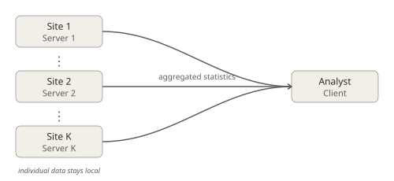
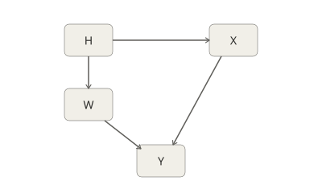
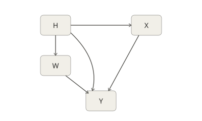

```{r, include = FALSE}
knitr::opts_chunk$set(
  collapse = TRUE,
  comment = "#>"
)

eval_chunks <- requireNamespace("dsRctFed",       quietly = TRUE) &&
               requireNamespace("dsRctFedClient", quietly = TRUE) &&
               requireNamespace("MASS",           quietly = TRUE) &&
               requireNamespace("DSLite",         quietly = TRUE) &&
               requireNamespace("dsBaseClient",   quietly = TRUE)

knitr::opts_hooks$set(eval = function(options) {
  if (isTRUE(options$eval) && !eval_chunks) options$eval <- FALSE
  options
})
```

```{r setup, eval = FALSE}
# This chunk is intentionally not evaluated; actual library loading happens
# in the first example chunk below so that eval_chunks guards it correctly.
library(dsRctFedClient)
```
## Description

Randomized Controlled Trials (RCTs) are the gold standard for estimating causal treatment effects, as randomization ensures that treatment assignment is independent of patient characteristics, allowing for unbiased estimation of the Average Treatment Effect (ATE). In practice, however, individual RCTs are often limited in sample size, patient diversity, or generalizability. Combining evidence across multiple trials conducted at different sites is therefore highly desirable, but raises an immediate obstacle: individual-level data are frequently siloed across institutions due to privacy regulations, ethical constraints, or data governance policies, making naive data centralization infeasible.

Federated learning offers a principled solution to this tension. Rather than centralizing data, federated approaches coordinate model fitting across sites by exchanging only intermediate quantities — such as model parameters or gradients — so that raw patient records never leave their originating site. However, translating this paradigm to causal inference is non-trivial. Federated learning was originally developed for predictive modeling, where the goal is to minimize a shared loss function across sites. Causal inference pursues a fundamentally different objective — estimating treatment effects — which requires careful modeling of both outcome and treatment assignment mechanisms across heterogeneous populations, and cannot be reduced to a standard prediction task.

This vignette demonstrates how to use the package to estimate the ATE across multiple RCTs in exactly this federated setting. The package is built on top of **DataSHIELD**, leveraging `dsBaseClient::ds.glm` to fit two federated linear regressions — one for each treatment arm — directly on the decentralized data. The resulting model parameters are then shared back, each site computes its local ATE via the Plug-in G-Formula, and these estimates are aggregated into a global ATE, following the federated estimator of @khellaf2025. We can think of this method as conducting an individual patient data (IPD) meta-analysis, but without pooling the raw data into a central location. Instead, the data remains distributed across participating sites.

**Organisation.** The vignette is structured as follows. The Background section introduces the causal and statistical framework, the federated learning setup, and the local testing infrastructure used throughout. Four worked examples then illustrate the method under progressively richer conditions: Example 1 covers the baseline homogeneous setting and verifies that the federated estimator matches the centralised one; Example 2 shows how DataSHIELD's disclosure controls interact with the estimation and when they block it; Example 3 extends the analysis to heterogeneous covariate distributions across sites; and Example 4 addresses study-specific intercept shifts that would otherwise confound the estimator.

## How to install

The latest release of the package can be installed through CRAN (soon):

```{r, eval=FALSE}
install.packages("dsRctFedClient")
```

Note that, in addition to this package, a server-side package must also be installed. In practice, it must be deployed on each server (i.e., the machines hosting the data). This can be done via

```{r, eval=FALSE}
install.packages("dsRctFed")
```

## Background

### Causal inference

The estimand of interest throughout this vignette is the **Average Treatment Effect (ATE)**. We work in the **potential outcomes framework** [@rubin1974; @imbens_rubin_2015]. Consider $n$ individuals distributed across $K$ sites — hospitals, clinical trial centres, or cohorts — with site $k$ holding $n_k$ observations, $\sum_{k=1}^K n_k = n$. For individual $i$ in site $k$, let $X_{ki} \in \mathbb{R}^d$ denote baseline covariates, $Y_{ki} \in \mathbb{R}$ the observed outcome, and $W_{ki} \in \{0,1\}$ the treatment indicator.

We posit two potential outcomes: $Y_{ki}^{(0)}$, the outcome that *would* be observed under control, and $Y_{ki}^{(1)}$, the outcome that *would* be observed under treatment. Only one is ever realised — this is the fundamental problem of causal inference. We rely on three standard assumptions to link these counterfactuals to observed data.

**SUTVA** requires (i) *no interference*: each individual's potential outcomes are unaffected by the treatments received by others — ruling out, for example, herd-immunity effects in vaccine trials, or resource-spillover effects when a drug is in limited supply; and (ii) *no hidden versions of treatment*: there is a single, well-defined version of each treatment level, meaning "receiving treatment" is the same experience for every patient (same drug, same dose, same protocol). The second part is often overlooked but can fail subtly, for instance if "surgery" is performed by different teams with different techniques.

**Consistency** bridges the counterfactual notation and the observed data: $Y_{ki} = W_{ki}\,Y_{ki}^{(1)} + (1-W_{ki})\,Y_{ki}^{(0)}$. It simply states that what we observe is the potential outcome corresponding to the treatment actually received. Rather than an independent assumption, this follows directly from the single-version requirement of SUTVA.

Since all examples concern **randomised controlled trials (RCTs)**, treatment is assigned independently of potential outcomes at every site,
$$W_{ki} \perp\!\!\!\perp \bigl(Y_{ki}^{(0)},\, Y_{ki}^{(1)}\bigr) \mid H = k, \quad \text{for all } k \in \{1, \ldots, K\},$$
and positivity holds ($0 < p_k < 1$ for all $k$). Together, these conditions ensure that the ATE,
$$\tau^\star = \mathbb{E}\!\left[Y^{(1)} - Y^{(0)}\right],$$
is nonparametrically identified, i.e., it can be estimated from the observed data. We estimate $\tau^\star$ via the **plug-in G-formula**: arm-specific outcome models are fitted on each treatment arm across all participating sites; each site $k$ then computes its local ATE $\hat\tau_k$ using the shared model parameters, and the global estimate is the sample-size-weighted average,
$$\hat\tau = \sum_{k=1}^K \frac{n_k}{n}\,\hat\tau_k.$$

### Federated learning

As mentioned, centralizing individual-level data from multiple sites into a single repository is often difficult or infeasible because of privacy, logistical, competitive, and governance constraints. **Federated learning** offers a principled alternative to data pooling: rather than moving the data, the analyst sends a query to each site, which performs computations on its local dataset and returns only aggregated statistics. Individual-level records never leave their originating site.

This package is built on top of **DataSHIELD**, which provides exactly this infrastructure for clinical and population research. The figure below illustrates the setup.

```{r fig-federated, echo=FALSE, out.width="350px", fig.align="center", fig.cap="Federated setup: each site holds private data and communicates only aggregated statistics to the analyst."}

```

The two server-side operations used throughout this vignette are:

- **`dsBaseClient::ds.glm`**: fits a generalised linear model federatively across all sites. Each server transmits a $(d+1) \times (d+1)$ information matrix and a $(d+1)$-vector per IRLS iteration; the client aggregates these and broadcasts the updated coefficients. For linear (Gaussian) models, IRLS converges in a single iteration.
- **`localAteDS`**: called server-side after model fitting. Returns per-site scalar summaries — site sample size $n_k$, local ATE $\hat\tau_k$, and (optionally) residual sum of squares $\mathrm{RSS}_k$ — used to construct the global ATE and its variance. No individual-level quantities are transmitted.

### Estimation for continuous outcomes

All examples in this vignette concern **continuous outcomes** modeled by **linear regression**. In particular, even under model misspecification, covariate adjustment via linear regression always reduces the asymptotic variance relative to the unadjusted difference-in-means and remains unbiased [@wager2024, Chapter 1]. For each treatment arm $w \in \{0, 1\}$, we solve
$$(\hat\alpha_w,\, \hat\beta_w) = \underset{\alpha,\, \beta}{\arg\min} \sum_{k=1}^K\sum_{i:\, W_{ki} = w} \left(Y_{ki} - \alpha - \beta^\top X_{ki}\right)^2$$
federatively via `dsBaseClient::ds.glm`. Because the outcome model is linear, this yields the exact pooled solution — no approximation is involved.

Each site $k$ then computes its local ATE by applying the shared coefficients $(\hat\alpha_0, \hat\beta_0, \hat\alpha_1, \hat\beta_1)$ via the plug-in G-formula:
$$\hat\tau_k = \frac{1}{n_k}\sum_{i=1}^{n_k} \left[(\hat\alpha_1 + \hat\beta_1^\top X_{ki}) - (\hat\alpha_0 + \hat\beta_0^\top X_{ki})\right].$$
The $n_k/n$ weights target the treatment effect on the pooled population $\sum_{k=1}^K \rho_k P_k$, where $\rho_k = P(H=k)$ [@berenfeld2025causal].

### Local testing with DSLite

In a real DataSHIELD deployment, each participating site needs to run its own dedicated server, and the analyst connects to these servers remotely. Setting up such infrastructure requires server access, network configuration, and institutional coordination.

For pedagogical and reproducibility purposes, we use the **DSLite** package throughout this vignette, which emulates a federated DataSHIELD infrastructure on a single computer by creating lightweight virtual servers inside the local R session. Each server holds its own dataset, enforces disclosure controls, and returns only aggregated results.

In a real multi-site study, the same workflow would be run against remote institutional servers.

```{r, eval=TRUE}
library(dsRctFedClient)
library(dsRctFed)    # server package, needed to register methods in the local DSLite simulation
library(DSLite)
library(MASS)
```

### Privacy settings

DataSHIELD servers enforce disclosure controls through a set of configurable thresholds. Two are particularly relevant here. The `datashield.privacyControlLevel` option sets the overall stringency of the privacy policy; the default level `"banana"` blocks known inference attacks while permitting a degree of subsetting flexibility. The `nfilter.glm` option controls how many observations a treatment arm must have before a GLM can be fitted: specifically, it requires the number of observations to be at least $(d+1)/\texttt{nfilter.glm}$, where $d$ is the number of covariates. At the default value of $0.33$, this means roughly three observations per parameter — a safeguard against models so saturated that individual records could be reconstructed from the output.

All examples set these options explicitly so that the privacy context is unambiguous. Examples 1 and 3 use the default privacy values (`"banana"` and `0.33`) while Example 2 and Example 4 use different ones, as later explained.

## Example 1

This first example reproduces the simulation setting of Appendix C.1 of @khellaf2025, 
which considers $K$ sites with balanced sample sizes and homogeneous covariate 
distributions. The main purpose is to illustrate that the federated approach yields 
exactly the same result as if the computation had been carried out in a centralized setting.

### Mathematical Formulation

**Data generation.** Covariates are drawn from $X_{ki} \sim \mathcal{N}(\mu_X, \Sigma_X)$ with the same distribution across all sites — the patient population is **homogeneous**. Treatment is assigned as $W_{ki} \sim \mathrm{Bernoulli}(p_k)$ independently of $X_{ki}$. Potential outcomes follow a linear model,
$$Y_{ki}^{(w)} = \alpha_w + \beta_w^\top X_{ki} + \varepsilon_{ki}^{(w)}, \qquad \varepsilon_{ki}^{(w)} \stackrel{\mathrm{iid}}{\sim} \mathcal{N}(0,\,\sigma^2), \quad w \in \{0,1\},$$
so the ATE evaluates to
$$\tau^\star = (\alpha_1 - \alpha_0) + (\beta_1 - \beta_0)^\top \mu_X.$$

```{r graphical-model, echo=FALSE, out.width="250px", fig.align="center", fig.cap="Causal relationships: site membership H influences treatment assignment W; both treatment W and covariates X affect outcome Y"}

```

**Variance estimation.** The asymptotic variance of $\hat\tau$ is derived in @khellaf2025 (Table 1). We estimate it by plugging in sample quantities:
$$\hat{V}(\hat\tau) = \frac{\hat\sigma^2}{n\,\hat{p}(1-\hat{p})} + \frac{\Delta\hat\beta^\top\hat\Sigma\Delta\hat\beta}{n},$$
where \(\hat{p} = n^{(1)}/n\) is the observed treatment proportion, \(\Delta\hat\beta = \hat\beta_1 - \hat\beta_0\), and \(\hat\Sigma\) is the pooled sample covariance of the covariates. The noise term uses
$$\hat\sigma^2 = \frac{\sum_k \mathrm{RSS}_k}{n - 2(d+1)},$$
where \(\mathrm{RSS}_k = \sum_{i=1}^{n_k}(Y_{ki} - \hat{Y}_{ki})^2\) is the residual sum of squares at server \(k\), computed under the federated arm-specific models with the global coefficients. An approximate 95% confidence interval is \(\hat\tau \pm 1.96\sqrt{\hat{V}(\hat\tau)}\).

### Parameters

The parameters  defined in Appendix C.1 of @khellaf2025 are 

```{r, eval=TRUE}
set.seed(123)

# Parameters
K <- 5  # number of studies
d <- 10 # dimension
n_per_study <- 20 * d
p_treatment <- c(0.65, 0.65, 0.65, 0.35, 0.35) # probability of treatment assignment 

# Outcome model parameters
sigma_noise <- 1.0
alpha_0 <- -2
alpha_1 <- -1.85

beta_1 <- seq(-1.75, 0.5, by = 0.25)
beta_0 <- seq(-1.8, 0, by = 0.2)

mu_X <- c(rep(1, d %/% 2), rep(-1, d %/% 2))
I_d <- diag(d)                  # identity matrix
J <- matrix(1, nrow = d, ncol = d)  # matrix of all ones
Sigma_X <-  0.5 * I_d + 0.5 * J
```

Note that, under this model, the true ATE is given by

```{r, eval=TRUE}
true_ATE <- (alpha_1 - alpha_0) + sum(mu_X * (beta_1 - beta_0))
print(true_ATE)
```

### Data Generation

```{r, eval = TRUE}
data_list <- list() # list that will contain K data frames (one per site)

for (k in 1:K) {
  n_k <- n_per_study
  X_k <- mvrnorm(n = n_k, mu = mu_X, Sigma = Sigma_X)
  W_k <- rbinom(n = n_k, size = 1, prob = p_treatment[k])

  epsilon_0 <- rnorm(n_k, mean = 0, sd = sigma_noise)
  epsilon_1 <- rnorm(n_k, mean = 0, sd = sigma_noise)

  Y_0 <- alpha_0 + X_k %*% beta_0 + epsilon_0 # potential outcome under control
  Y_1 <- alpha_1 + X_k %*% beta_1 + epsilon_1 # potential outcome under treatment
  Y_obs <- W_k * Y_1 + (1 - W_k) * Y_0    # observed outcome

  # Create data frame for the current study
  data_list[[k]] <- data.frame(
    subject_id = 1:n_k,
    W = W_k,
    Y = as.vector(Y_obs),
    X_k
  )
  colnames(data_list[[k]]) <- c("subject_id", "W", "Y", paste0("X", 1:d))
}

pooled_data <- do.call(rbind, data_list)
```

### Creation of DSLite Servers

With $n_k = 200$ and minimum treatment probability $0.35$, the expected minority arm size is $70$ — well above the `nfilter.glm` threshold of $(d+1)/0.33 \approx 33$. We therefore use the default `banana` privacy settings.

```{r, eval = TRUE}
options(
  datashield.privacyControlLevel = "banana",
  nfilter.glm                    = 0.33
)

for (k in 1:K) {
  server_name <- paste0("dslite.server", k)

  # Create server k holding the k-th data frame
  server_obj <- DSLite::newDSLiteServer(
    tables = list(study_data = data_list[[k]])
  )

  # Configure the server to include the required packages.
  server_obj$config(defaultDSConfiguration(include = c("dsBase", "dsRctFed")))
  server_obj$aggregateMethod("localAteDS", "localAteDS")

  # Assign it to the environment with the name `server_name`
  assign(server_name, server_obj, envir = .GlobalEnv)
}
```

Now create the login configurations

```{r, eval = TRUE}
builder <- DSI::newDSLoginBuilder()

# Add each server using a loop
for (k in 1:K) {
  builder$append(
    server = paste0("study", k),
    url = paste0("dslite.server", k),
    table = "study_data",
    driver = "DSLiteDriver"
  )
}

logindata <- builder$build()
```

and login while assigning the name `base` to the server's data frame

```{r, eval = TRUE}
conns <- DSI::datashield.login(logins = logindata, assign = FALSE)
DSI::datashield.assign.table(
  conns = conns,
  table = "study_data",
  symbol = "base"
)
```

### Federated Estimation of the ATE

```{r, results = 'hide', message = FALSE}
base_name <- "base"                    # Name of the dataset symbol on each server
outcome_name <- "Y"                    # Outcome variable
treatment_name <- "W"                  # Treatment variable
covariate_names <- paste0("X", 1:d)    # Covariates X1, X2, ..., Xd
federated_ate <- ds.EstimateAte(
  datasources     = conns,
  base_name       = base_name,
  outcome_name    = outcome_name,
  treatment_name  = treatment_name,
  covariate_names = covariate_names,
  heterogeneous   = FALSE
)
```

The federated ATE, its standard error, and the 95% confidence interval are:

```{r, eval = TRUE}
cat(sprintf("ATE: %.4f  SE: %.4f  95%% CI: [%.4f, %.4f]  True ATE: %.4f\n",
            federated_ate$ate, sqrt(federated_ate$variance),
            federated_ate$ci_lower, federated_ate$ci_upper, true_ATE))
```

We now compute the pooled estimator, i.e., the one obtained by centralizing the data.

```{r, eval = TRUE}
pooled_data_treated <- pooled_data[pooled_data$W == 1, ]
pooled_data_control <- pooled_data[pooled_data$W == 0, ]

formula <- paste0(outcome_name, " ~ ", paste(covariate_names, collapse = " + "))

model_treated <- glm(formula = formula, family = gaussian, data = pooled_data_treated)
model_control <- glm(formula = formula, family = gaussian, data = pooled_data_control)

coef_treated <- model_treated$coefficients
coef_control <- model_control$coefficients

alpha1 <- coef_treated["(Intercept)"]
alpha0 <- coef_control["(Intercept)"]
beta1 <- coef_treated[covariate_names]
beta0 <- coef_control[covariate_names]

tau_diff <- alpha1 - alpha0
gamma_diff <- beta1 - beta0

X_mat <- as.matrix(pooled_data[, covariate_names, drop = FALSE])
x_bar <- colMeans(X_mat, na.rm = TRUE)
pooled_ate <- as.numeric(tau_diff + sum(x_bar * gamma_diff))
```

To finish, we show that the pooled estimator is equal to the federated one

```{r, eval = TRUE}
isTRUE(all.equal(pooled_ate, federated_ate$ate))
```

```{r, eval = TRUE}
DSI::datashield.logout(conns)
```

## Example 2 — The role of privacy settings

This second example illustrates how DataSHIELD's disclosure controls interact with the federated estimation. We use the same model parameters and covariate distribution as Example 1, but with more extreme treatment probabilities: three sites assign treatment with probability 0.9 and two sites with probability 0.1.

```{r, eval = TRUE}
p_treatment_2 <- c(0.9, 0.9, 0.9, 0.1, 0.1)
```

With `n_per_study = 200` and `d = 10` covariates, the two sites with `p = 0.1` will have on average only 20 treated observations. DataSHIELD's `nfilter.glm` threshold requires each arm to have at least `(d + 1) / nfilter.glm = 11 / 0.33 ≈ 33` observations before fitting a GLM — so those sites will be blocked.

### Data generation

Only `p_treatment` changes; everything else is inherited from Example 1.

```{r, eval = TRUE}
data_list_2 <- vector("list", K)
for (k in 1:K) {
  X_k     <- mvrnorm(n = n_per_study, mu = mu_X, Sigma = Sigma_X)
  W_k     <- rbinom(n = n_per_study, size = 1, prob = p_treatment_2[k])
  Y_0     <- alpha_0 + X_k %*% beta_0 + rnorm(n_per_study, sd = sigma_noise)
  Y_1     <- alpha_1 + X_k %*% beta_1 + rnorm(n_per_study, sd = sigma_noise)
  Y_obs   <- W_k * Y_1 + (1 - W_k) * Y_0
  data_list_2[[k]] <- data.frame(
    subject_id = 1:n_per_study, W = W_k, Y = as.vector(Y_obs), X_k
  )
  colnames(data_list_2[[k]]) <- c("subject_id", "W", "Y", paste0("X", 1:d))
}
```

### Default settings — estimation is blocked

We set up the DSLite servers with the default `banana` privacy level and `nfilter.glm = 0.33`, then attempt the estimation.

```{r, eval = TRUE}
options(
  datashield.privacyControlLevel = "banana",
  nfilter.glm                    = 0.33
)

for (k in 1:K) {
  server_name <- paste0("dslite.server2_", k)
  server_obj  <- DSLite::newDSLiteServer(tables = list(study_data = data_list_2[[k]]))
  server_obj$config(DSLite::defaultDSConfiguration(include = c("dsBase", "dsRctFed")))
  server_obj$aggregateMethod("localAteDS", "localAteDS")
  assign(server_name, server_obj, envir = .GlobalEnv)
}

builder2 <- DSI::newDSLoginBuilder()
for (k in 1:K) {
  builder2$append(
    server = paste0("study", k),
    url    = paste0("dslite.server2_", k),
    table  = "study_data",
    driver = "DSLiteDriver"
  )
}
conns_2 <- DSI::datashield.login(logins = builder2$build(), assign = FALSE)
DSI::datashield.assign.table(conns = conns_2, table = "study_data", symbol = "base")
```

```{r, eval = TRUE, error = TRUE}
ds.EstimateAte(
  datasources     = conns_2,
  base_name       = "base",
  outcome_name    = outcome_name,
  treatment_name  = treatment_name,
  covariate_names = covariate_names,
  heterogeneous   = FALSE
)
```

As expected, the call fails: the sites with very few treated (or control) observations are blocked by the GLM saturation filter.

### Permissive settings — estimation succeeds

By switching to `permissive` mode and raising `nfilter.glm` to `1.0`, the constraint becomes: block only if the number of parameters exceeds the number of observations — a condition that is never met here. We rebuild the servers with these relaxed settings and rerun.

```{r, eval = TRUE}
options(
  datashield.privacyControlLevel = "permissive",
  nfilter.glm                    = 1.0
)

for (k in 1:K) {
  server_name <- paste0("dslite.server2_", k)
  server_obj  <- DSLite::newDSLiteServer(tables = list(study_data = data_list_2[[k]]))
  server_obj$config(DSLite::defaultDSConfiguration(include = c("dsBase", "dsRctFed")))
  server_obj$aggregateMethod("localAteDS", "localAteDS")
  assign(server_name, server_obj, envir = .GlobalEnv)
}

conns_2 <- DSI::datashield.login(logins = builder2$build(), assign = FALSE)
DSI::datashield.assign.table(conns = conns_2, table = "study_data", symbol = "base")
```

```{r, results = 'hide', message = FALSE}
federated_ate_2 <- ds.EstimateAte(
  datasources     = conns_2,
  base_name       = "base",
  outcome_name    = outcome_name,
  treatment_name  = treatment_name,
  covariate_names = covariate_names,
  heterogeneous   = FALSE
)
```

```{r, eval = TRUE}
cat(sprintf("ATE: %.4f  SE: %.4f  95%% CI: [%.4f, %.4f]  True ATE: %.4f\n",
            federated_ate_2$ate, sqrt(federated_ate_2$variance),
            federated_ate_2$ci_lower, federated_ate_2$ci_upper, true_ATE))
```

The estimation now succeeds. Note, however, that the standard error is larger than in Example 1: the extreme imbalance in treatment allocation reduces the effective sample size for both arms, inflating the variance of the ATE estimator.

We now compute the pooled estimator on the centralized data from Example 2 and verify that it matches the federated one.

```{r, eval = TRUE}
pooled_data_2 <- do.call(rbind, data_list_2)
pooled_data_treated_2 <- pooled_data_2[pooled_data_2$W == 1, ]
pooled_data_control_2 <- pooled_data_2[pooled_data_2$W == 0, ]

model_treated_2 <- glm(formula = formula, family = gaussian, data = pooled_data_treated_2)
model_control_2 <- glm(formula = formula, family = gaussian, data = pooled_data_control_2)

coef_treated_2 <- model_treated_2$coefficients
coef_control_2 <- model_control_2$coefficients

alpha1_2 <- coef_treated_2["(Intercept)"]
alpha0_2 <- coef_control_2["(Intercept)"]
beta1_2  <- coef_treated_2[covariate_names]
beta0_2  <- coef_control_2[covariate_names]

tau_diff_2   <- alpha1_2 - alpha0_2
gamma_diff_2 <- beta1_2 - beta0_2

X_mat_2 <- as.matrix(pooled_data_2[, covariate_names, drop = FALSE])
x_bar_2 <- colMeans(X_mat_2, na.rm = TRUE)
pooled_ate_2 <- as.numeric(tau_diff_2 + sum(x_bar_2 * gamma_diff_2))
```

```{r, eval = TRUE}
isTRUE(all.equal(pooled_ate_2, federated_ate_2$ate))
```

```{r, eval = TRUE}
DSI::datashield.logout(conns_2)
```

## Example 3 — Heterogeneous covariate distributions

This third example reproduces the simulation setting of Appendix C.3 of @khellaf2025,
which extends the homogeneous setup of Example 1 to the case where each site recruits
from a **different patient population**. Both the covariate mean $\mu_k$ and covariance
$\Sigma_k$ now vary across sites, reflecting the reality that multi-site trials
often recruit from geographically or demographically distinct patient pools. As in
Example 1, treatment probabilities also differ across sites ($p_k \neq p_{k'}$), so
study membership $H$ influences both the covariate distribution $X$ and treatment
assignment $W$.

The estimator and the federated/pooled equivalence remain valid under distributional
shift. However, the homogeneous variance formula of Example 1 relies on the assumption
that  $\mu_k$ is constant across sites and is no longer appropriate here.
The correct variance estimator uses the per-arm Gram matrix inverses returned by
`ds.glm(viewVarCov = TRUE)`, activated by passing `heterogeneous = TRUE` to
`ds.EstimateAte()`.

### Mathematical Formulation

**Data generation.** The graphical model now includes arrows from $H$ (study membership) to both $X$ (covariates) and $W$ (treatment), since the covariate distribution and the treatment probability both depend on the site. For individual $i$ in site $k$, covariates are drawn as $X_{ki} \sim \mathcal{N}(\mu_k, \Sigma_k)$ with site-specific mean and covariance. Treatment is assigned as $W_{ki} \sim \mathrm{Bernoulli}(p_k)$ independently of $X_{ki}$, so randomization is preserved at every site. Potential outcomes follow the same linear model as in Example 1.

```{r graphical-model-het, echo = FALSE, out.width = "250px", fig.align = "center", fig.cap = "Causal relationships under distributional shift: site membership H influences both covariate distribution X and treatment assignment W; treatment W and covariates X affect outcome Y"}

```

**Local and global ATEs.** Because the covariate means differ across sites, so do the
site-specific ATEs:
$$\tau_k^\star = (\alpha_1 - \alpha_0) + (\beta_1 - \beta_0)^\top \mu_k.$$
The global ATE, targeting the pooled population, is their weighted average under the
mixing proportions $\rho_k = P(H = k)$, estimated by $n_k/n$:
$$\tau^\star = \sum_{k=1}^K \rho_k\,\tau_k^\star
= (\alpha_1 - \alpha_0) + (\beta_1 - \beta_0)^\top\bar\mu,
\qquad \bar\mu = \sum_k \rho_k\,\mu_k.$$

**Variance estimation.** Under distributional shift, the  asymptotic variance
of $\hat\tau$  is:
$$\hat{V}(\hat\tau) = \underbrace{\bar{X}^{\prime\top}\!\left(\widehat{\mathrm{Cov}}(\hat\theta^{(1)}) +
\widehat{\mathrm{Cov}}(\hat\theta^{(0)})\right)\!\bar{X}^{\prime}}_{\text{OLS noise}} +
\underbrace{\frac{\Delta\hat\beta^\top\hat\Sigma\Delta\hat\beta}{n}}_{\text{covariate scatter}},$$
where $\bar{X}^{\prime} = (1,\,\bar{X})^\top$ is the augmented pooled covariate mean and
$\widehat{\mathrm{Cov}}(\hat\theta^{(w)}) = \hat\sigma^2(\tilde{X}^{(w)\top}\tilde{X}^{(w)})^{-1}$
is the standard OLS covariance matrix of the arm-$w$ coefficient vector, returned directly
by `ds.glm(viewVarCov = TRUE)`. The OLS noise term replaces the closed-form
$\hat\sigma^2/[n\hat{p}(1-\hat{p})]$ of Example 1 with this expression, which is valid
under full heterogeneity. The covariate scatter term and the noise variance
$\hat\sigma^2 = \sum_k \mathrm{RSS}_k / [n - 2(d+1)]$ are estimated exactly as in
Example 1.

**Shared information.** Two additional disclosure steps are required relative to
Example 1. First, `ds.glm(viewVarCov = TRUE)` makes each server return the $(d+1)\times(d+1)$
scaled variance–covariance matrix of the arm-specific GLM coefficients. Second, `localAteDS` with
`heterogeneous = TRUE` returns the column sums $n_k\bar{X}_k$ of the covariate matrix,
which the client aggregates to form the global covariate mean $\bar{X}$.

### Parameters

The parameters defined in Appendix C.3 of @khellaf2025 are

```{r, eval = TRUE}
set.seed(123)

K           <- 5
d           <- 10
# Imbalanced sample sizes (inspired by Appendix C.2.2):
# one large study and four smaller ones, same total n as the balanced case.
n_list      <- c(600, 120, 120, 120, 120)
sigma_noise <- 1.0
alpha_0     <- -2
alpha_1     <- -1.85
beta_1      <- seq(-1.75, 0.5, by = 0.25)
beta_0      <- seq(-1.8,  0.0, by = 0.2)

p_treatment_het <- c(0.65, 0.65, 0.65, 0.35, 0.35) # site-specific treatment probabilities

# Site-specific covariate means — Appendix C.3
mu_list <- list(
  c(rep( 1.0, d / 2), rep(-1.0, d / 2)),
  c(rep(-1.0, d / 2), rep( 1.0, d / 2)),
  rep(0, d),
  c(rep( 0.5, d / 2), rep(-1.0, d / 2)),
  c(rep( 1.2, d / 2), rep( 0.8, d / 2))
)

I_d <- diag(d)
J   <- matrix(1, nrow = d, ncol = d)

# Site-specific covariance matrices — Appendix C.3
Sigma_1    <- 0.5 * I_d + 0.5 * J
Sigma_list <- list(
  Sigma_1,
  20 * Sigma_1 + 0.5 * I_d - 0.5 * J,
  0.02 * Sigma_1 + 0.7  * I_d,
  1.0  * Sigma_1 + 0.5  * I_d - 0.15 * J,
  1.5  * Sigma_1 + 0.5  * I_d - 0.15 * J
)
```

The true ATE is the $n_k/n$-weighted average of the site-specific ATEs
(since study sizes differ, equal-weight averaging would target a different estimand):

```{r, eval = TRUE}
tau_k_vec    <- sapply(mu_list, function(mu_k) {
  (alpha_1 - alpha_0) + sum(mu_k * (beta_1 - beta_0))
})
true_ATE_het <- sum(n_list * tau_k_vec) / sum(n_list)
print(true_ATE_het)
```

### Data Generation

```{r, eval = TRUE}
data_list_het <- vector("list", K) # list that will contain K data frames (one per site)
for (k in 1:K) {
  n_k   <- n_list[k]
  X_k   <- mvrnorm(n = n_k, mu = mu_list[[k]], Sigma = Sigma_list[[k]])
  W_k   <- rbinom(n = n_k, size = 1, prob = p_treatment_het[k])
  Y_0   <- alpha_0 + X_k %*% beta_0 + rnorm(n_k, sd = sigma_noise) # potential outcome under control
  Y_1   <- alpha_1 + X_k %*% beta_1 + rnorm(n_k, sd = sigma_noise) # potential outcome under treatment
  Y_obs <- W_k * Y_1 + (1 - W_k) * Y_0                             # observed outcome
  # Create data frame for the current study
  data_list_het[[k]] <- data.frame(
    subject_id = 1:n_k, W = W_k, Y = as.vector(Y_obs), X_k
  )
  colnames(data_list_het[[k]]) <- c("subject_id", "W", "Y", paste0("X", 1:d))
}
pooled_data_het <- do.call(rbind, data_list_het)
```

### Creation of DSLite Servers

Even the smallest studies ($n_k = 120$) have a minimum expected arm size of
$0.35 \times 120 = 42$ observations — comfortably above the `nfilter.glm` threshold of
$(d+1)/0.33 \approx 33$. We therefore use the default `banana` privacy settings.

```{r, eval = TRUE}
options(
  datashield.privacyControlLevel = "banana",
  nfilter.glm                    = 0.33
)

for (k in 1:K) {
  server_name <- paste0("dslite.server_het", k)
  server_obj  <- DSLite::newDSLiteServer(tables = list(study_data = data_list_het[[k]]))
  server_obj$config(DSLite::defaultDSConfiguration(include = c("dsBase", "dsRctFed")))
  server_obj$aggregateMethod("localAteDS", "localAteDS")
  assign(server_name, server_obj, envir = .GlobalEnv)
}

builder_het <- DSI::newDSLoginBuilder()
for (k in 1:K) {
  builder_het$append(
    server = paste0("study", k),
    url    = paste0("dslite.server_het", k),
    table  = "study_data",
    driver = "DSLiteDriver"
  )
}

conns_het <- DSI::datashield.login(logins = builder_het$build(), assign = FALSE)
DSI::datashield.assign.table(conns = conns_het, table = "study_data", symbol = "base")
```

### Federated Estimation of the ATE

We pass `heterogeneous = TRUE` to use the OLS covariance-based variance formula, which is appropriate here because the covariate distributions differ across sites.

```{r, results = 'hide', message = FALSE}
federated_ate_het <- ds.EstimateAte(
  datasources     = conns_het,
  base_name       = base_name,
  outcome_name    = outcome_name,
  treatment_name  = treatment_name,
  covariate_names = covariate_names,
  heterogeneous   = TRUE
)
```

The federated ATE, its standard error, and the 95% confidence interval are:

```{r, eval = TRUE}
cat(sprintf("ATE: %.4f  SE: %.4f  95%% CI: [%.4f, %.4f]  True ATE: %.4f\n",
            federated_ate_het$ate, sqrt(federated_ate_het$variance),
            federated_ate_het$ci_lower, federated_ate_het$ci_upper, true_ATE_het))
```

We now verify that the federated ATE is identical to the pooled centralised estimator.

```{r, eval = TRUE}
pooled_treated_het <- pooled_data_het[pooled_data_het$W == 1, ]
pooled_control_het <- pooled_data_het[pooled_data_het$W == 0, ]

formula_het   <- paste0(outcome_name, " ~ ", paste(covariate_names, collapse = " + "))

model_treated_het <- glm(formula = formula_het, family = gaussian, data = pooled_treated_het)
model_control_het <- glm(formula = formula_het, family = gaussian, data = pooled_control_het)

coef_treated_het <- model_treated_het$coefficients
coef_control_het <- model_control_het$coefficients

alpha1_het <- coef_treated_het["(Intercept)"]
alpha0_het <- coef_control_het["(Intercept)"]
beta1_het  <- coef_treated_het[covariate_names]
beta0_het  <- coef_control_het[covariate_names]

x_bar_het      <- colMeans(as.matrix(pooled_data_het[, covariate_names]))
pooled_ate_het <- as.numeric(
  (alpha1_het - alpha0_het) + sum(x_bar_het * (beta1_het - beta0_het))
)
```

```{r, eval = TRUE}
isTRUE(all.equal(pooled_ate_het, federated_ate_het$ate))
```

```{r, eval = TRUE}
DSI::datashield.logout(conns_het)
```

## Example 4 — Study effects

Even when randomisation is correctly implemented at every site, multi-centre RCTs routinely exhibit systematic differences in **baseline outcome levels** across centres. These **study effects** are conceptually distinct from the distributional shift addressed in Example 3: they do not arise from recruiting different patient populations, but from unmeasured **centre-level factors** that shift outcomes additively at every site, independently of patient characteristics. Typical drivers include differences in standard-of-care practices, investigator expertise and training, local therapeutic protocols, or the way outcomes are ascertained and recorded. Formally, centre $k$ contributes a scalar $h_k \in \mathbb{R}$ that is added identically to both potential outcomes (model (16) of @khellaf2025), so the individual treatment effect $Y^{(1)} - Y^{(0)}$ — and hence the ATE — is unaffected by $h_k$.

The statistical challenge arises when study effects coexist with heterogeneous treatment probabilities: centre membership $H$ then simultaneously affects the outcome $Y$ (through $h_k$) and the treatment assignment $W$ (through $p_k$), opening a confounding path $H \to Y$ alongside $H \to W$ that violates the ignorability assumption in the pooled data. A centre with a large $h_k$ and a high $p_k$ will simultaneously have more treated observations *and* an elevated outcome baseline, causing naïve estimators to conflate the treatment effect with the site-level intercept shifts. We first demonstrate this bias, then show how passing `study_effects = TRUE` to `ds.EstimateAte()` corrects it by augmenting the design matrix with study membership dummies, implementing the adjusted GD estimator $\hat\tau$ (Definition 9 of @khellaf2025).

### Mathematical Formulation

**Data generation.** The data-generating model combines the distributional shift of Example 3 with a study-specific intercept $h_k \in \mathbb{R}$ added to both potential outcomes:
$$Y_{ki}^{(w)} = \alpha_w + h_k + \beta_w^\top X_{ki} + \varepsilon_{ki}^{(w)}, \qquad \varepsilon_{ki}^{(w)} \stackrel{\mathrm{iid}}{\sim} \mathcal{N}(0, \sigma^2),$$
where covariates are drawn as $X_{ki} \sim \mathcal{N}(\mu_k, \Sigma_k)$ with the same site-specific parameters as Example 3. Because $h_k$ appears identically in both arms, it cancels in the individual treatment effect $Y_{ki}^{(1)} - Y_{ki}^{(0)}$.

```{r graphical-model-study, echo = FALSE, out.width = "250px", fig.align = "center", fig.cap = "Causal relationships under study effects: centre H influences covariate distribution X and treatment assignment W, and directly shifts outcome Y through study-specific intercepts; treatment W and covariates X affect outcome Y"}

```

**Local and global ATEs.** The site-specific ATEs and the global ATE are therefore:
$$\tau_k^\star = (\alpha_1 - \alpha_0) + (\beta_1 - \beta_0)^\top\mu_k, \qquad
\tau^\star = \sum_{k=1}^K \rho_k\,\tau_k^\star,$$
where $\rho_k = P(H = k)$, estimated by $n_k / n$.

**Confounding.** The graphical model contains directed paths $H \to W$ (through $p_k$), $H \to X$ (through $\mu_k$, $\Sigma_k$), and $H \to Y$ (through $h_k$), making $H$ a confounder on both the covariate and outcome channels (Figure 3 of @khellaf2025). The unadjusted pooled estimator is biased whenever $p_k$ are not equal across studies (Appendix B.4.1 of @khellaf2025): the regression on the treatment arm conflates the arm-specific sample composition with the treatment effect.

**Adjusted estimator.** The bias is removed by augmenting each server's design matrix with $K - 1$ integer study-dummy columns $(H_2, \ldots, H_K)$, where $H_{k,j} = \mathbf{1}\{k = j\}$. The arm-specific linear regressions are fitted on the extended matrix $\tilde{X}_{k,i} = (1, X_{k,i}, H_{2,k,i}, \ldots, H_{K,k,i})$, absorbing the $h_k$ shifts. The resulting adjusted estimator is unbiased and achieves the same asymptotic variance as the unadjusted estimator — the $h_k$ terms cancel exactly in $\hat\theta^{(1)} - \hat\theta^{(0)}$ and do not inflate the variance (Appendix B.4.2 of @khellaf2025).

### Parameters

The outcome model parameters and the study effects match Appendix C.4 of @khellaf2025. The covariate distributions are taken from Example 3 (Appendix C.3).

```{r, eval = TRUE}
set.seed(123)

K           <- 5
d           <- 10
# Imbalanced sample sizes: one large study and four equal-sized ones.
# Small studies use n = 300 so that the minority arm (~30 observations with
# p = 0.1 or p = 0.9) safely exceeds the (d + K) / nfilter.glm = 15 threshold
# imposed by study_effects = TRUE, which adds K - 1 = 4 dummy covariates.
n_list      <- c(600, 300, 300, 300, 300)
sigma_noise <- 1.0
alpha_0     <- -2
alpha_1     <- -1.85
beta_1      <- seq(-1.75, 0.5,  by = 0.25)
beta_0      <- seq(-1.8,  0.0,  by = 0.2)

# Site-specific covariate means — same as Example 3 (Appendix C.3)
mu_list <- list(
  c(rep( 1.0, d / 2), rep(-1.0, d / 2)),
  c(rep(-1.0, d / 2), rep( 1.0, d / 2)),
  rep(0, d),
  c(rep( 0.5, d / 2), rep(-1.0, d / 2)),
  c(rep( 1.2, d / 2), rep( 0.8, d / 2))
)

I_d     <- diag(d)
J       <- matrix(1, nrow = d, ncol = d)
Sigma_1 <- 0.5 * I_d + 0.5 * J

# Site-specific covariance matrices — same as Example 3 (Appendix C.3)
Sigma_list <- list(
  Sigma_1,
  20 * Sigma_1 + 0.5 * I_d - 0.5 * J,
  0.02 * Sigma_1 + 0.7  * I_d,
  1.0  * Sigma_1 + 0.5  * I_d - 0.15 * J,
  1.5  * Sigma_1 + 0.5  * I_d - 0.15 * J
)

# Study effects — Appendix C.4
h_k           <- c(1, 2, -1, 30, 2)

# Imbalanced treatment probabilities — Large regime of Appendix C.4
p_treatment_3 <- c(0.9, 0.9, 0.9, 0.1, 0.1)
```

The true ATE is the $n_k/n$-weighted average of the site-specific ATEs (the $h_k$ terms cancel in $Y^{(1)} - Y^{(0)}$, so they do not affect it):

```{r, eval = TRUE}
tau_k_vec <- sapply(mu_list, function(mu_k) {
  (alpha_1 - alpha_0) + sum(mu_k * (beta_1 - beta_0))
})
true_ATE <- sum(n_list * tau_k_vec) / sum(n_list)
print(true_ATE)
```

### Data Generation

```{r, eval = TRUE}
data_list_3 <- vector("list", K) # list that will contain K data frames (one per site)
for (k in 1:K) {
  n_k <- n_list[k]
  X_k <- mvrnorm(n = n_k, mu = mu_list[[k]], Sigma = Sigma_list[[k]])
  W_k <- rbinom(n = n_k, size = 1, prob = p_treatment_3[k])

  Y_0   <- alpha_0 + h_k[k] + X_k %*% beta_0 + rnorm(n_k, sd = sigma_noise) # potential outcome under control
  Y_1   <- alpha_1 + h_k[k] + X_k %*% beta_1 + rnorm(n_k, sd = sigma_noise) # potential outcome under treatment
  Y_obs <- W_k * Y_1 + (1 - W_k) * Y_0                                        # observed outcome

  # Create data frame for the current study
  data_list_3[[k]] <- data.frame(
    subject_id = 1:n_k, W = W_k, Y = as.vector(Y_obs), X_k
  )
  colnames(data_list_3[[k]]) <- c("subject_id", "W", "Y", paste0("X", 1:d))
}
```

### Creation of DSLite Servers

We use permissive privacy settings because the extreme treatment probabilities ($p = 0.9$ or $p = 0.1$) produce very small arm-specific samples at some centres, which would otherwise be blocked by the default `nfilter.glm` threshold. The interaction between privacy settings and estimation was already illustrated in Example 2.

```{r, eval = TRUE}
options(
  datashield.privacyControlLevel = "permissive",
  nfilter.glm                    = 1.0
)

for (k in 1:K) {
  server_name <- paste0("dslite.server3_", k)
  server_obj  <- DSLite::newDSLiteServer(tables = list(study_data = data_list_3[[k]]))
  server_obj$config(DSLite::defaultDSConfiguration(include = c("dsBase", "dsRctFed")))
  server_obj$aggregateMethod("localAteDS", "localAteDS")
  server_obj$assignMethod("addStudyIdDS", "addStudyIdDS")
  assign(server_name, server_obj, envir = .GlobalEnv)
}

builder3 <- DSI::newDSLoginBuilder()
for (k in 1:K) {
  builder3$append(
    server = paste0("study", k),
    url    = paste0("dslite.server3_", k),
    table  = "study_data",
    driver = "DSLiteDriver"
  )
}
conns_3 <- DSI::datashield.login(logins = builder3$build(), assign = FALSE)
DSI::datashield.assign.table(conns = conns_3, table = "study_data", symbol = "base")
```

### Unadjusted Estimation — Bias Under Study Effects

Without adjustment, the estimator conflates the treatment effect with the study-level intercept shifts. Centre 4 has both a very large study effect ($h_4 = 30$) and a low treatment probability ($p_4 = 0.1$): most of its observations are controls, making the treatment arm appear systematically different in ways that are entirely explained by the study effect rather than by the treatment itself.

```{r, results = 'hide', message = FALSE}
federated_ate_unadj <- ds.EstimateAte(
  datasources     = conns_3,
  base_name       = "base",
  outcome_name    = outcome_name,
  treatment_name  = treatment_name,
  covariate_names = covariate_names,
  study_effects   = FALSE,
  heterogeneous   = TRUE
)
```

```{r, eval = TRUE}
cat(sprintf("Unadjusted ATE: %.4f   bias: %.4f   (true ATE: %.4f)\n",
            federated_ate_unadj$ate,
            federated_ate_unadj$ate - true_ATE,
            true_ATE))
```

The bias is substantial: the unadjusted estimator departs markedly from the true ATE.

### Adjusted Estimation — Accounting for Study Effects

Setting `study_effects = TRUE` instructs `ds.EstimateAte()` to call `addStudyIdDS()` on each server, which appends $K - 1 = 4$ binary columns (`study_id2`, ..., `study_id5`) to the local data frame. The arm-specific GLMs are then fitted on the augmented design matrix $(1, X_1, \ldots, X_{10}, H_2, \ldots, H_5)$, absorbing the $h_k$ shifts and removing the confounding. Because covariate distributions differ across centres (as in Example 3), we also pass `heterogeneous = TRUE` to use the OLS-covariance-based variance formula, which is valid under distributional shift. No individual-level data are shared at any point.

```{r, results = 'hide', message = FALSE}
federated_ate_adj <- ds.EstimateAte(
  datasources     = conns_3,
  base_name       = "base",
  outcome_name    = outcome_name,
  treatment_name  = treatment_name,
  covariate_names = covariate_names,
  study_effects   = TRUE,
  heterogeneous   = TRUE
)
```

```{r, eval = TRUE}
cat(sprintf("Adjusted ATE: %.4f  SE: %.4f  95%% CI: [%.4f, %.4f]  True ATE: %.4f\n",
            federated_ate_adj$ate, sqrt(federated_ate_adj$variance),
            federated_ate_adj$ci_lower, federated_ate_adj$ci_upper, true_ATE))
```

The adjusted estimator is close to the true ATE, confirming that conditioning on study membership removes the bias. The confidence interval covers the true value.

### Comparison with the Pooled Adjusted Estimator

We verify that the federated adjusted estimator recovers exactly the same ATE as the centralised analysis on the augmented design matrix — a consequence of the pooling property of the estimator (Theorem 1 of @khellaf2025).

```{r, eval = TRUE}
pooled_data_3          <- do.call(rbind, data_list_3)
pooled_data_3$study_id <- factor(rep(1:K, times = n_list))  # study 1 is reference

formula_adj <- paste0(outcome_name, " ~ ",
                      paste(covariate_names, collapse = " + "),
                      " + study_id")

pooled_treated_3 <- pooled_data_3[pooled_data_3$W == 1, ]
pooled_control_3 <- pooled_data_3[pooled_data_3$W == 0, ]

model_treated_3 <- glm(formula = formula_adj, family = gaussian, data = pooled_treated_3)
model_control_3 <- glm(formula = formula_adj, family = gaussian, data = pooled_control_3)

alpha1_3 <- coef(model_treated_3)["(Intercept)"]
alpha0_3 <- coef(model_control_3)["(Intercept)"]

# Use model.matrix so coefficient names match exactly what glm() produced
X_mat_3      <- model.matrix(as.formula(sub(paste0(outcome_name, " ~ "), "~ ", formula_adj)),
                             data = pooled_data_3)[, -1L, drop = FALSE]
x_bar_3      <- colMeans(X_mat_3)
slope_names  <- colnames(X_mat_3)
gamma_diff_3 <- coef(model_treated_3)[slope_names] - coef(model_control_3)[slope_names]

pooled_ate_3 <- as.numeric((alpha1_3 - alpha0_3) + sum(x_bar_3 * gamma_diff_3))
```

```{r, eval = TRUE}
isTRUE(all.equal(pooled_ate_3, federated_ate_adj$ate))
```

```{r, eval = TRUE}
DSI::datashield.logout(conns_3)
```

## References

